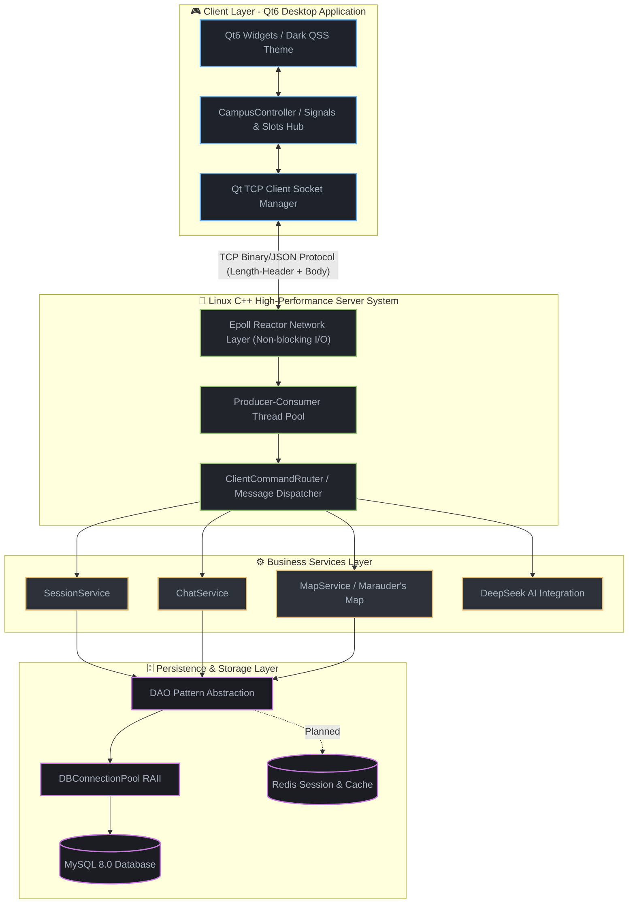

# Arcane Campus Online 🏰

> A multiplayer online text RPG social platform built with C++20, MySQL, and Qt6.
>
> 基于 C++20 + MySQL + Qt6 构建的多人在线文字 RPG 社交平台。

---

## 项目简介 / About

### 中文

**Arcane Campus Online** 是一个以魔法校园为背景的多人在线文字 RPG 社交平台。

项目从一个轻量级 Socket 聊天室开始，逐步演进为支持多场景、多角色、实时互动的虚拟校园世界。玩家以角色身份进入世界，在礼堂、图书馆、天文塔、公共休息室等场景中进行聊天、社交、探索与互动。

除了构建一个完整的文字世界之外，本项目也是一个持续迭代的 Linux 网络编程与桌面应用实践平台，用于探索现代 C++ 后端开发中的分层架构、数据库设计、连接池、以及客户端开发技术。

> 本项目为非商业同人作品。
> Harry Potter © J.K. Rowling / Warner Bros. 版权所有。

### English

**Arcane Campus Online** is a multiplayer online text RPG social platform inspired by the magical world of Harry Potter.

Starting from a lightweight socket chatroom, the project gradually evolves into a multi-scene, multi-character, real-time interactive virtual campus. Players enter the world as characters and interact with others in locations such as the Great Hall, Library, Astronomy Tower, Dormitories, and more.

The platform aims to provide an immersive text-based social experience while serving as a practical playground for modern C++ backend architecture, database engineering, and desktop client development.

> Fan Project — Non-commercial use only.
> Harry Potter © J.K. Rowling / Warner Bros. All rights reserved.

---

## ✨ 已实现功能 / Implemented Features

### 🎮 客户端 (Qt6 Desktop Client)

| 功能 | 说明 |
|------|------|
| 🪄 登录系统 | 选择学院、定制魔杖、真实数据库验证 |
| 🏠 主界面 | 8 个功能 Widget + 暗色魔法主题 |
| 💬 聊天事件面板 | 羊皮纸风格，支持多频道（Location / World / Party）|
| 📖 对角巷序章 | 四家商店自由探索、采购闭环、断点续玩 |
| ⌨️ 自由行动输入 | 中英文动作解析；按钮是建议而非唯一路径 |
| 🧠 NPC 记忆 | 交谈与忽略会改变好感和之后的招呼 |
| 📦 数据驱动剧情 | 商店、NPC、商品与双语叙事由 JSON 内容包提供 |
| ⚙️ 通用剧情引擎基础 | 类型化条件/效果、StoryDelta、统一叙事事件、内容校验与图可达性检查 |
| 🎭 剧情运行桥 | 提交成功后才把场景、旁白、NPC、玩家行动与选项送入中央叙事框 |
| 💾 剧情事务与恢复 | 原子保存金币、背包、NPC 记忆、章节进度与事件日志；支持完整断点恢复 |
| 🎒 背包系统 | **真实数据库对接**（InventoryDAO）|
| 🗺️ 活点地图 | **真实数据库对接**（InventoryDAO + LocationDAO）|
| 📋 任务系统 | **真实数据库对接**（QuestDAO）|
| 👤 角色状态面板 | 显示学院、等级、位置、状态 |
| 🕐 校园时钟 | 实时刷新 |
| 🏆 学院积分排行 | 4 个学院实时排名 |
| 🤖 NPC AI 对话 | DeepSeek API 驱动 |

DeepSeek 密钥只从本机设置或环境变量读取，不进入源码与 Git。配置方式与安全边界见
[docs/AI_CONFIGURATION.md](docs/AI_CONFIGURATION.md)。

### 🗄️ 后端数据层（MySQL）

| 模块 | 状态 |
|------|------|
| 真实 MySQL 驱动（MySqlDatabaseDriver） | ✅ 动态加载 libmysql.dll |
| 数据库连接池（RAII） | ✅ |
| INI 配置加载（DatabaseConfigLoader） | ✅ |
| 15 张表完整 Schema（含剧情状态、魔杖与 NPC 记忆） | ✅ |
| 种子数据（3 个测试用户 + 4 个角色 + 活点地图道具） | ✅ |

---

## 🛠️ 技术栈 / Tech Stack

| 层次 / Layer | 技术 / Technology |
|---|---|
| 开发语言 / Language | **C++20** |
| 操作系统 / OS | Windows / Linux（开发用 Windows，生产用 Ubuntu） |
| 数据库 / Database | **MySQL 8.0**（InnoDB, utf8mb4）|
| 数据库抽象 | **Strategy Pattern · Connection Pool (RAII) · DAO Pattern** |
| 服务端分层 | Controller → Service → DAO → DO / DTO / VO |
| 客户端 / Client | **Qt6 Widgets** · QSS 主题（墨绿炭黑·Quiet Library Theme） |
| 缓存系统 / Cache | Redis（规划中） |
| 构建工具 / Build | CMake + CTest |

---

## 🏗️ 系统架构 / Architecture



### 服务端分层 / Server Layering

| 层 | 命名空间 | 目录 | 职责 |
|---|---------|------|------|
| **Controller** | `arcane::application::controller` | `src/application/controller/` | 信号槽路由，参数绑定 |
| **Service** | `arcane::application::service` | `src/application/service/` | 核心业务逻辑编排，DAO 注入 |
| **DAO** | `arcane::database` | `database/include/, database/src/` | 数据库 CRUD，参数化查询 |
| **DO** | `arcane::application::do_model` | `src/application/do/` | 数据库表映射对象 |
| **DTO** | `arcane::application::dto` | `src/application/dto/` | 请求参数封装 |
| **VO** | `arcane::application::vo` | `src/application/vo/` | 接口返回视图对象 |
| **Router** | `arcane::application::router` | `src/application/router/` | 未来 TCP 网络层的命令路由预留 |

---

## 📂 项目结构 / Project Structure

```
HogwartsOnline/
├── CMakeLists.txt                      # 顶层构建脚本
│
├── database/                           # ── 数据层（独立静态库）──
│   ├── include/                        # DAO + 驱动接口（14 个 hpp）
│   │   ├── IDatabaseDriver.hpp
│   │   ├── DBConnection.hpp
│   │   ├── DBConnectionPool.hpp
│   │   ├── DatabaseConfigLoader.hpp
│   │   ├── RecordMapper.hpp
│   │   └── User/Character/Room/Friend/Message/NPC/
│   │       Inventory/Quest/Location/StoryDAO.hpp
│   │
│   ├── src/                            # DAO + 驱动实现（全部真实 SQL）
│   │   ├── MySqlDatabaseDriver.cpp     # MySQL C API（动态加载 libmysql.dll）
│   │   ├── NoopDatabaseDriver.cpp
│   │   └── 10 个 DAO.cpp
│   │
│   ├── sql/                            # 数据库脚本
│   │   ├── init_mysql.sql              # 完整数据库建表
│   │   ├── seed_mysql.sql              # 种子数据（用户、角色、活点地图道具等）
│   │   └── migrate_v1-v4*.sql           # 增量迁移（v4：通用剧情状态与事件日志）
│   │
│   ├── scripts/                        # PowerShell 脚本
│   │   ├── import_mysql.ps1
│   │   └── verify_mysql.ps1
│   │
│   ├── seed_redis_commands.txt
│   └── config/database.ini.example     # 数据库配置模板
│
├── src/                                # ── 应用层（Qt6 客户端）──
│   ├── main.cpp                        # 入口：数据库接入 + 信号槽连接
│   │
│   ├── application/
│   │   ├── do/CampusDO.hpp             # 4 个 DO
│   │   ├── dto/CampusDTO.hpp           # 8 个 DTO
│   │   ├── vo/CampusVO.hpp             # 8 个 VO + 1 别名
│   │   ├── service/
│   │   │   ├── SessionService          # ✅ 接 UserDAO+CharacterDAO（真实登录）
│   │   │   ├── ChatService             # ✅ 接 MessageDAO（聊天持久化）
│   │   │   ├── InventoryService        # ✅ 接 InventoryDAO
│   │   │   ├── QuestService            # ✅ 接 QuestDAO
│   │   │   ├── MapService              # ✅ 接 InventoryDAO+LocationDAO（活点地图）
│   │   │   ├── CampusService           # 🔧 硬编码（待接 RoomDAO）
│   │   │   └── SocialService           # 🔧 硬编码（待接 FriendDAO）
│   │   ├── prologue/
│   │   │   ├── PrologueService         # ✅ 新生创建 → 对角巷 → 魔杖领取闭环
│   │   │   └── WandLoreService         # ✅ DeepSeek 解读 + 本地降级档案
│   │   ├── diagon_alley/
│   │   │   ├── DiagonAlleyCatalog       # ✅ JSON 内容包读取与查询
│   │   │   ├── DiagonAlleyActionParser  # ✅ 中英文自由行动解析
│   │   │   └── DiagonAlleyService       # ✅ 商店、采购、NPC 记忆与完成条件
│   │   ├── story/
│   │   │   ├── StoryTypes               # ✅ 通用条件、效果、状态与 StoryDelta
│   │   │   ├── StoryContentLoader        # ✅ JSON 白名单解析
│   │   │   ├── StoryContentValidator     # ✅ 引用、双语与可达性校验
│   │   │   ├── StoryEngine               # ✅ 确定性条件判断与内存执行
│   │   │   ├── StoryRuntimeService        # ✅ 先提交状态，再向中央叙事框发布事件
│   │   │   ├── persistence/
│   │   │   │   └── StoryPersistenceService # ✅ StoryDelta 原子提交与完整状态恢复
│   │   │   └── adapters/
│   │   │       └── DiagonAlleyChapterAdapter # ✅ 旧内容到通用章节的迁移桥
│   │   ├── controller/
│   │   │   └── CampusController        # 信号槽枢纽（16 slots + 6 signals）
│   │   └── router/
│   │       └── ClientCommandRouter     # ✅ 未来 TCP 网络层命令路由预留
│   │
│   ├── ui/
│   │   ├── LoginWindow.{h,cpp}         # 登录窗口
│   │   ├── EnrollmentDialog.{h,cpp}    # 新生档案与魔杖登记
│   │   ├── MainWindow.{h,cpp}          # 主窗口
│   │   └── widgets/                    # 8 个功能 Widget
│   │       ├── CampusTimeWidget
│   │       ├── CharacterStatusWidget
│   │       ├── ChatEventWidget
│   │       ├── CourseScheduleWidget
│   │       ├── HouseRankingWidget
│   │       ├── InventoryWidget
│   │       ├── LocationActionBar
│   │       └── MemberListWidget
│   │
│   └── resources/
│       ├── resources.qrc
│       ├── data/diagon_alley.json       # 对角巷双语剧情内容包
│       ├── story/schemas/                # Agent 可读取的内容包 v2 契约
│       └── qss/dark_wood.qss           # 墨绿炭黑主题（Quiet Library Theme）
│
├── docs/
│   ├── AI_CONFIGURATION.md             # DeepSeek 本地安全配置说明
│   ├── CONTENT_PACKS.md                 # 剧情内容包格式与扩展边界
│   └── STORY_ENGINE.md                  # 通用引擎、白名单与事务边界
│
├── tests/                              # 单元测试
│   ├── application/
│   │   └── DiagonAlleyRuntimeTest.cpp  # 内容包、解析、记忆与采购闭环
│   ├── story/
│   │   ├── StoryEngineTest.cpp          # 通用加载、校验、执行与安全拒绝
│   │   ├── StoryRuntimeServiceTest.cpp   # 提交边界、自由输入与中央叙事信号
│   │   ├── StoryPersistenceServiceTest.cpp # 多表事务、恢复、并发版本与回滚
│   │   └── DiagonAlleyParityTest.cpp    # 新旧完整游玩结果等价性
│   └── database/
│       ├── DatabaseSmokeTest.cpp       # 冒烟测试（无需数据库）
│       └── MySqlIntegrationTest.cpp    # MySQL 集成测试
│
└── README.md
```

---

## 📊 当前进度 / Progress

### ✅ 已完成 / Completed

- [x] UDP Chatroom Demo
- [x] Thread Pool
- [x] Producer-Consumer Architecture
- [x] Modular Project Structure
- [x] **MySQL Integration** (真实驱动 + 连接池 + 10 个 DAO)
- [x] **Qt Desktop Client** (UI 完整 + 暗色魔法主题)
- [x] **真实登录系统** (数据库验证用户名+学院)
- [x] **背包系统** (真实数据库 CRUD)
- [x] **活点地图** (道具校验 + 在线玩家位置查询)
- [x] **任务系统** (任务列表 + 进度更新)
- [x] **聊天持久化** (MessageDAO 写入)
- [x] **AI NPC 系统** (DeepSeek API 集成)
- [x] **新生对角巷闭环** (魔杖、四店采购、金币与背包)
- [x] **剧情断点续玩** (章节、场景、采购状态、魔杖与 NPC 记忆)
- [x] **自由行动解析** (中英文自然输入 → 确定性剧情动作)
- [x] **数据驱动内容包** (剧情文案与配置从 JSON 加载)
- [x] **通用剧情引擎第一阶段** (类型、加载、校验、StoryDelta、v4 事务基础)
- [x] **通用叙事输出** (场景、旁白、NPC、玩家行动、系统、选项与完成事件)
- [x] **剧情运行桥** (StoryRuntimeService 提交成功后再驱动中央叙事框)
- [x] **剧情事务与恢复** (金币、背包、NPC 记忆、章节状态和事件日志原子提交)

### 🚧 进行中 / In Progress

- [ ] TCP Persistent Connection (ClientCommandRouter 已预留)
- [ ] Epoll-based High Concurrency Refactor

### 📋 规划中 / Planned

- [ ] Redis Integration（缓存层）
- [ ] Room System 完整实现（CampusService 接 RoomDAO）
- [ ] Friend System 完整实现（SocialService 接 FriendDAO）
- [ ] Achievement System
- [ ] Persistent world data storage（聊天历史归档）

---

## 🚀 快速开始 / Quick Start

### 环境要求 / Prerequisites

| 依赖 | 版本 |
|------|------|
| CMake | 3.20+ |
| Qt6 | 6.5+ (Widgets 组件) |
| MySQL | 8.0+ |
| MySQL C API | 8.0+ (libmysql.dll / libmysqlclient) |
| 编译器 | MSVC 2022 / MinGW / GCC 11+ |
| C++ 标准 | C++20 |

### 1️⃣ 初始化数据库 / Initialize Database

```powershell
# Windows PowerShell
cd database/scripts
.\import_mysql.ps1
```

或者手动在 Navicat / MySQL CLI 中执行：

```bash
mysql -u root -p < database/sql/init_mysql.sql
mysql -u root -p < database/sql/seed_mysql.sql
```

### 2️⃣ 配置数据库连接 / Configure Database

复制配置模板并修改密码：

```bash
cp database/config/database.ini.example database.ini
```

编辑 `database.ini`：

```ini
driver=mysql
host=127.0.0.1
port=3306
database=arcane_campus_online
username=root
password=******            ; 修改为你的 MySQL 密码
character_set=utf8mb4
client_library_path=D:/mysql-8.0.25-winx64/bin/libmysql.dll
```

> **或者**设置环境变量 `ARCANE_DB_PASSWORD`，密码不会被提交到 git。
> **或者**设置环境变量 `ARCANE_DB_CONFIG` 指定配置文件路径。

### 3️⃣ 构建项目 / Build

```bash
mkdir build && cd build
cmake .. -G "MinGW Makefiles"   # 或者 "Visual Studio 17 2022"
cmake --build .
```

### 4️⃣ 运行 / Run

```bash
./HogwartsOnline.exe           # Windows
./HogwartsOnline               # Linux
```

---

## 🧪 测试 / Testing

```bash
cd build
ctest --output-on-failure
```

测试类型：
- **DatabaseSmokeTest** — 冒烟测试，无需数据库
- **MySqlIntegrationTest** — MySQL 集成测试（需先初始化数据库）
- **StoryEngineTest** — 通用条件、效果、叙事事件与安全拒绝
- **StoryRuntimeServiceTest** — 提交后发布与中央叙事框信号
- **StoryPersistenceServiceTest** — 完整恢复、多表原子提交、并发版本拒绝与失败回滚
- **DiagonAlleyParityTest** — 新旧对角巷完整游玩结果等价性

---

## 🧪 测试账号 / Test Accounts

种子数据中包含以下测试用户：

| 用户名 | 学院 | 说明 |
|--------|------|------|
| `raven_test` | Ravenclaw | 拥有活点地图道具，可测试 Marauder's Map |
| `gryffin_test` | Gryffindor | - |
| `slyther_test` | Slytherin | - |

---

## 🎯 项目目标 / Goals

- Practice modern C++ backend engineering and Linux network programming.
- Explore high-concurrency server design patterns (Epoll + Reactor planned).
- Build a long-term portfolio project demonstrating system architecture skills.
- Accumulate experience in database engineering, connection pooling, and desktop application development.

---

## 👤 作者 / Author

CS Student · Backend & Systems Enthusiast

Currently learning and experimenting with:

* Modern C++ / C++20
* Linux Network Programming
* Concurrency & Server Architecture
* Database Fundamentals
* Qt Desktop Development

Mostly learning by building small projects and messing around with ideas I find interesting.

---

## 📄 License

MIT License — See [LICENSE](./LICENSE) for details.

> Fan Project · Non-commercial use only.
> Harry Potter © J.K. Rowling / Warner Bros.
